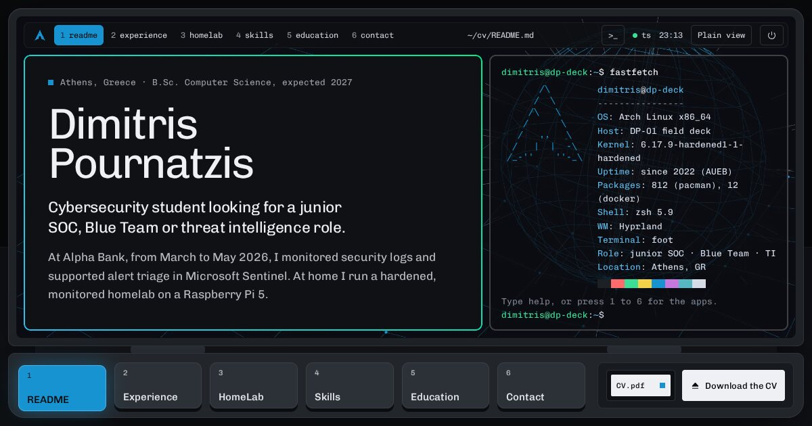
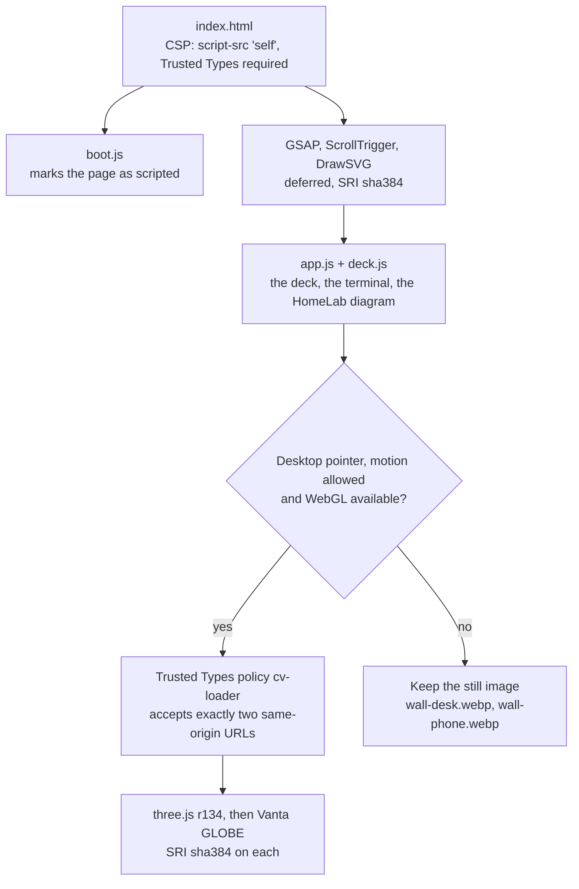

# Dimitris Pournatzis: CV

<p align="center">
  <a href="https://dimpourn.github.io/DimPournCV/">
    
  </a>
</p>

<p align="center">
  <a href="https://dimpourn.github.io/DimPournCV/"><b>Live site</b></a> ·
  <a href="https://dimpourn.github.io/Dimitris-Pournatzis-CV.pdf"><b>PDF CV</b></a> ·
  <a href="https://dimpourn.github.io/sh_lab/">Homelab</a> ·
  <a href="https://www.linkedin.com/in/dimpournatzis/">LinkedIn</a>
</p>

Computer Science student (cybersecurity path) at AUEB, Resilience and Intelligence Intern at
Alpha Bank in 2026, looking for a junior SOC, Blue Team or threat intelligence role. This
repository is the source of my CV site: a static page hardened like a production web app, with
no third-party requests.

## The site

One page in plain HTML, CSS and JavaScript, served by GitHub Pages from `docs/`. It opens as a
cyberdeck running Arch Linux:

- a closed rugged case; opening it (click, tap or Enter) flips the lid and boots Arch (initramfs
  hooks, systemd, a tty1 login, Hyprland); any key skips it;
- on the desktop the CV sections are apps: six keys, the waybar workspaces and the 1 to 6 keys
  switch them, and the Arch logo opens a launcher;
- a foot terminal that takes commands (`help`, `ls`, `cat`, `man dimitris`, `fastfetch`, ...);
- the Vanta GLOBE as the wallpaper on desktop, with a pause toggle and a still image elsewhere;
- a HomeLab diagram that draws itself once, then shows packets moving through it;
- a phone layout with a 3 x 2 keypad and one window at a time.

**Plain view** is the same content as a normal page, one click away. It is also what you get
without JavaScript and when printing.

## How the page loads

Every script comes from this site and passes the Content Security Policy. The two heavy WebGL
libraries load only when they will be used, and only through one Trusted Types policy.



## Security posture

| Control | Implementation | How it is checked |
| --- | --- | --- |
| Content Security Policy | `default-src 'none'`, `script-src 'self'`, `style-src 'self'`, `base-uri 'none'`, `form-action 'none'`; no inline scripts, styles or event handlers | `tools/site.py check` reports CSP violations at ten screen sizes |
| Trusted Types | `require-trusted-types-for 'script'`; the only policy, `cv-loader`, accepts the three.js and Vanta URLs and nothing else; no HTML injection sinks in the code | Same check reports Trusted Types violations |
| Subresource Integrity | sha384 on all five vendor scripts, including the two loaded on demand | Each hash matches `openssl dgst -sha384 -binary <file> \| base64` |
| No third-party requests | Fonts, libraries and icons are self-hosted; no CDNs, trackers or analytics | `default-src 'none'` blocks every other origin |
| Pinned dependencies | GSAP 3.13.0, three.js r134, Vanta 0.5.24 | Checked against their npm tarball hashes ([credits](docs/assets/CREDITS.md)) |
| Links and referrer | `strict-origin-when-cross-origin`, `noopener noreferrer` on external links, `upgrade-insecure-requests` | Static review |
| Vulnerability contact | [`security.txt`](https://dimpourn.github.io/.well-known/security.txt) at the domain root, as RFC 9116 requires | n/a |

*(`frame-ancestors` and HSTS need HTTP headers, which GitHub Pages cannot set.)*

## Preview locally

```sh
python3 -m http.server --bind 127.0.0.1 -d docs 8000
```

Then open <http://127.0.0.1:8000/>. Binding to `127.0.0.1` keeps the server off your local network.

## Local tools

`tools/site.py` renders the images and checks the page in a real browser. It needs Playwright for
Python with Chromium, and ImageMagick 7 (`magick`). It serves `docs/` on `127.0.0.1` only.

| Command | What it does |
| --- | --- |
| `python3 tools/site.py poster` | Renders the globe stills: `globe.webp`, `globe-sm.webp` (plain view) and `wall-desk.webp`, `wall-phone.webp` (deck wallpaper) |
| `python3 tools/site.py og` | Renders the 1200×630 link preview `og.jpg` (the open deck) |
| `python3 tools/site.py deck [WxH ...]` | Opens the deck at ten screen sizes (or only the ones given), visits every app, runs the terminal and reports errors, CSP violations and overflow |
| `python3 tools/site.py check [WxH ...]` | Loads the plain view at ten screen sizes (or only the ones given) and reports console errors, CSP and Trusted Types violations and overflow; screenshots go to `shots/` |
| `python3 tools/site.py check-reduced [WxH ...]` | The same check with `prefers-reduced-motion: reduce` |

## Repository layout

| Path | Contents |
| --- | --- |
| `docs/` | The published site; GitHub Pages serves this folder |
| `docs/assets/` | CSS, JavaScript, self-hosted fonts, icons and images |
| `tools/site.py` | Local render and check script; not published |

## License

© Dimitris Pournatzis. My CV content, design and code are licensed under
[CC BY-NC-ND 4.0](LICENSE.md). Third-party files keep their own licences: GSAP (standard no-charge
licence), three.js and Vanta (MIT), the Chivo fonts (SIL OFL 1.1) and the product logos (CC0;
the marks belong to their owners). See [CREDITS.md](docs/assets/CREDITS.md).
